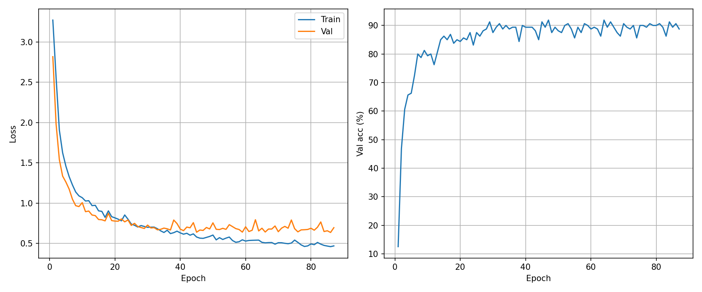
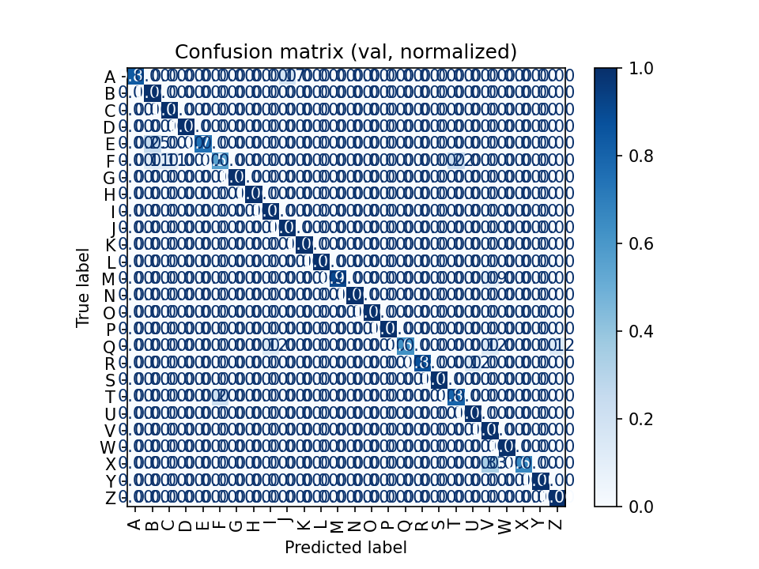
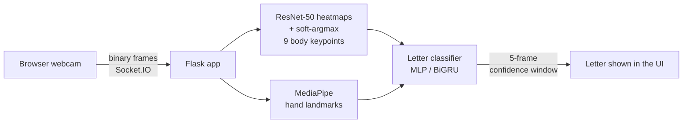

# Hear My Hands

**Real-time French Sign Language (LSF) fingerspelling recognition in the browser.**
Point a webcam at your hands, sign the alphabet, read the letters.

🏆 **Winner of the Prix Entreprise, Projet 2A, PeiP 2, Polytech Nantes (2025–2026)**

**[Live demo](https://hearmyhands.asia/translate)** · **[Technical whitepaper (EN)](https://nmqx.lol/hearmyhands_whitepaper.pdf)** · [Full report (FR)](https://hearmyhands.asia/rapport.pdf) · [Learn the alphabet (Anki mode)](https://hearmyhands.asia/learn)

> *Hear My Hands: Real-Time French Sign Language Fingerspelling Recognition with Integral Pose Regression, Hand Landmarks and a Bidirectional GRU*. 12-student team, supervised by the LS2N lab.

---

## Results

| | |
| --- | --- |
| Static letter classifier (MLP, 42 → 50 → 26) | **90.4 %** accuracy |
| Temporal classifier (bidirectional GRU, 799 gesture sequences) | **91.9 %** validation accuracy |
| Train / validation loss gap | **0.10** (0.56 vs 0.66) with rotation, scale, landmark-occlusion and noise augmentation |
| Upper-body pose | **9 keypoints**, ResNet-50 heatmaps + soft-argmax (integral regression), OKS loss |
| End-to-end throughput | **10–15 FPS** over binary WebSocket, 5-frame confidence window |

<p align="center">
  
  
</p>

## How it works



1. The browser streams webcam frames as **binary** Socket.IO messages (no base64 overhead).
2. A Flask server runs the vision models in-process: a **ResNet-50 heatmap network** regresses upper-body keypoints with **soft-argmax**, and **MediaPipe** extracts hand landmarks.
3. A **classifier** maps the landmarks to one of the 26 LSF letters: an MLP on single frames, or a **bidirectional GRU** over short sequences for letters that involve movement.
4. A 5-frame confidence window smooths the output before it reaches the UI.

The [whitepaper](https://nmqx.lol/hearmyhands_whitepaper.pdf) has the architecture, training setup and ablations.

## Repository layout

```
hearmyhands/   Flask web app (UI + WebSocket transport)
HmH/           Model API, training and inference scripts
docs/          Model flow and web stack notes (LaTeX + PDF)
```

## Quick start

```bash
python3 -m venv .venv
source .venv/bin/activate          # Windows: .\.venv\Scripts\Activate.ps1
pip install -r requirements.txt
```

Download `best.pt` from the [latest release](../../releases/latest) into `HmH/heatnoks/checkpoints/`, then:

```bash
python hearmyhands/app.py          # web app + model on :5000
```

Open <http://localhost:5000/translate>, allow the camera and click **Lancer Traduction**.

### Model on a separate machine (optional)

```bash
python HmH/api.py                            # terminal 1: model on :5001
USE_HTTP_MODEL=1 python hearmyhands/app.py   # terminal 2: web app on :5000
```

On Windows PowerShell: `$env:USE_HTTP_MODEL = "1"; python hearmyhands\app.py`.
`HmH/inference.py` is the single source of truth for inference; `HmH/api.py` is a thin Flask layer on top.

| Variable | Default |
| --- | --- |
| `USE_HTTP_MODEL` | `0` (in-process) |
| `MODEL_API_URL` | `http://127.0.0.1:5001/model_predict` |
| `SIGN_API_URL` | `http://127.0.0.1:5001/sign_predict` |
| `MODEL_TIMEOUT` | `5` |
| `PORT` | `5000` (web) / `5001` (model) |
| `USE_AMP` | `0` (fp16 opt-in, often slower) |

### Standalone inference

```bash
python HmH/heatnoks/inference_video.py --ckpt HmH/heatnoks/checkpoints/best.pt --source video.mp4   # video file
python HmH/heatnoks/inference_video.py --ckpt HmH/heatnoks/checkpoints/best.pt --source 0           # webcam
```

## What's next: Hear My Hands v2

v1 recognizes **fingerspelled letters**. v2 targets **continuous sign language translation** (LSF → French sentences) on the Mediapi-RGB corpus: a Conformer encoder over video and skeleton features, a pretrained French decoder, and self-supervised JEPA pretraining. Work in progress.

## Team

**12 students, PeiP 2A, Polytech Nantes**, in four teams:

| Team | Lead | Members |
| --- | --- | --- |
| Vision (body + hand skeleton) | Titouan DESAILLY | Maxime D'AURIA, Thibault CAPDEVIELLE, François DELAUNAY |
| Translation (MLP / GRU) | Killian SEVALLE | Dalyan PENISSON, Nathan DIZY, Louna PEJOT, Marius DEMONFAUCON |
| Interface & backend | Maxime D'AURIA | Kaelig LERAY, François DELAUNAY |
| Communication & design | Louna PEJOT | François DELAUNAY, Arthur PIERRE, Kaelig LERAY, Nestor CORABOEUF |

Project coordinator: **Marius DEMONFAUCON**. Contact: hearmyhands.polytech@gmail.com

**Supervisors, LS2N lab / Polytech Nantes:** Matthieu PERREIRA DA SILVA (AI), Paul TERRASSIN (PhD student, imaging / AI), Hélène PÉRENNOU (teaching).

**Tools and data:** [MediaPipe](https://github.com/google-ai-edge/mediapipe) (Google) for hand landmarks · [How2Sign](https://how2sign.github.io/) plus an in-house dataset recorded by the team · compute provided by the LS2N lab.

The project contributes to UN Sustainable Development Goals **10** (reduced inequalities) and **4** (quality education).

## License

Code under the [MIT license](LICENSE), with the agreement of the whole team.
Third-party resources keep their own licenses: MediaPipe (Apache 2.0) and [How2Sign](https://how2sign.github.io/) (CC BY-NC 4.0, non-commercial use).
